# HomeFix — mobile app

A React Native (Expo) app for an appliance repair business. Customers book and pay for repairs, technicians run their
visits from the phone, and the owner and managers run the day: one app, four roles.

This is the mobile client of **BusinessHub**, a booking and field-service system. It talks to the same API as the web app:
- Backend (Node.js, Express, PostgreSQL): [businesshub-backend](https://github.com/saierukala/businesshub-backend)
- Web app (Next.js): [businesshub-frontend](https://github.com/saierukala/businesshub-frontend)

**🎥 [Watch the demo video](https://drive.google.com/file/d/157z9WD6HO0IEs9F54uRjFi96dneqXbnd/view?usp=drive_link)**: booking, assigning a technician, the visit, approving an extra charge, paying with Razorpay on a real Android phone, and the owner's view.

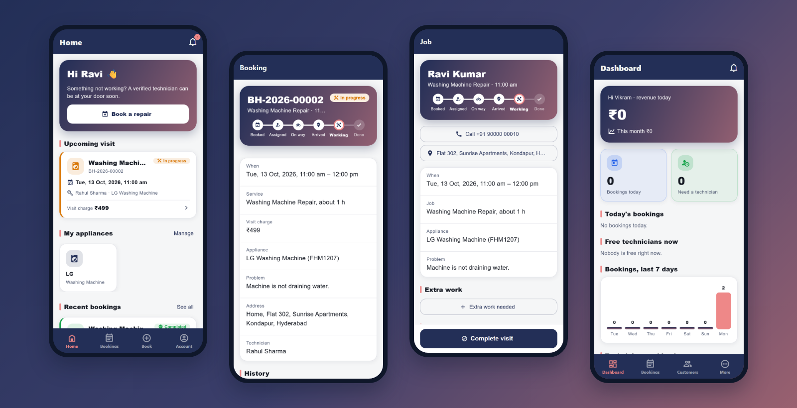

## What it does

| Role | In the app |
| --- | --- |
| **Customer** | Book a repair in 5 steps (appliance, problem and service, address, a free time slot, review), follow the visit on a step tracker, approve or decline an extra charge, pay online with Razorpay, get a receipt, leave a review, reschedule or cancel within the rules, manage addresses and appliances with their repair history. |
| **Technician** | Today's jobs, one-tap visit steps (On my way → Arrived → Start work → Complete), call or open the address in Maps, visit notes, ask the customer to approve extra work, collect cash or UPI, book a follow-up visit. |
| **Manager** | Dashboard, all bookings, assign or change the technician, book for customers who phone in (including phone-only customers with no email), customers, technicians (skills, areas, working hours, time off), the reassignment queue, reports, reviews. |
| **Owner** | Everything a manager can do, plus services and prices, users, the audit log, and a read-only roles & permissions overview. |

Every role also has notifications, a profile with photo, and Settings for light / dark mode and one of 8 app colours.

## Screenshots

| Log in | Customer home | Book: pick a time | Booking with live tracker |
| --- | --- | --- | --- |
| 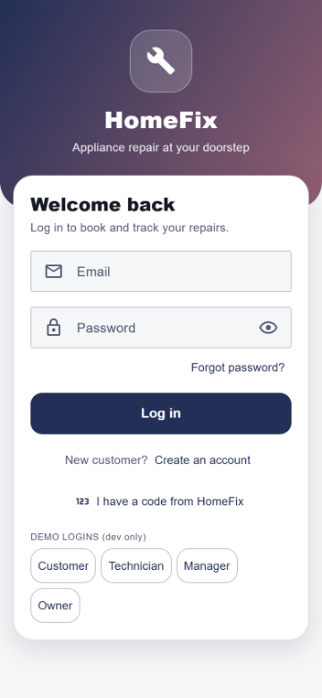 | 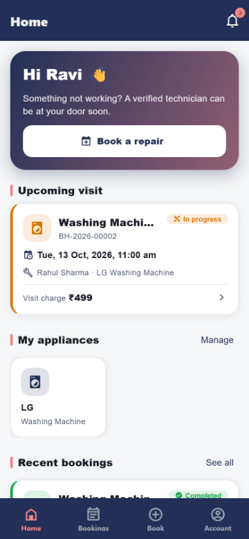 | 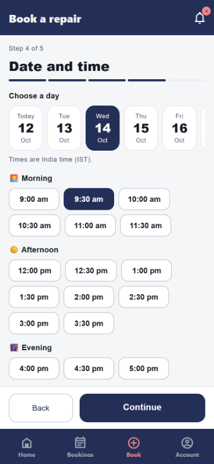 | 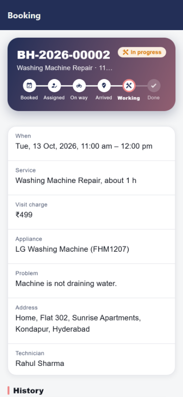 |

| Technician's job | Manager dashboard | Reports | Settings |
| --- | --- | --- | --- |
| 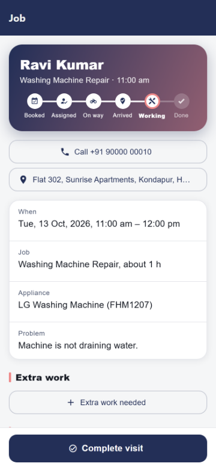 | 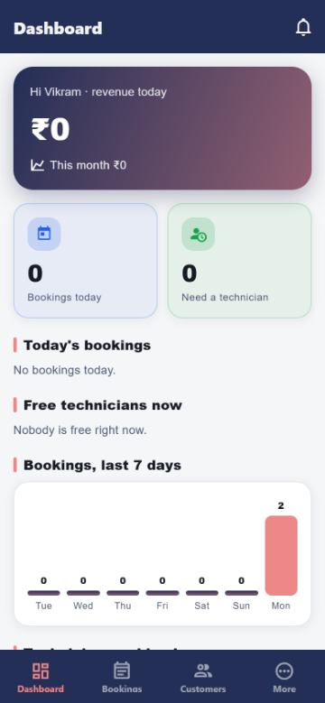 | 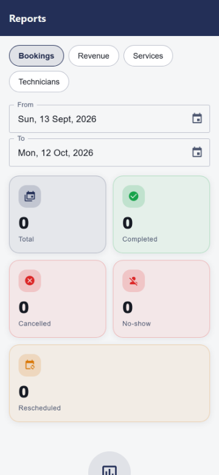 | 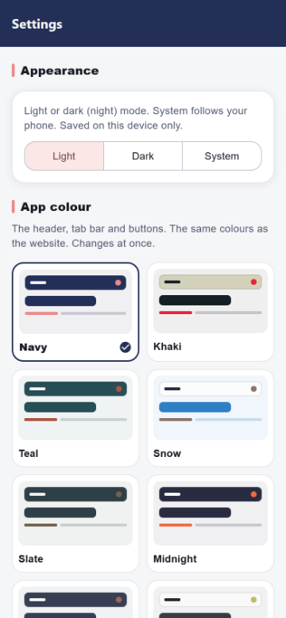 |

| Dark mode | Dark mode | Profile | Edit profile |
| --- | --- | --- | --- |
| 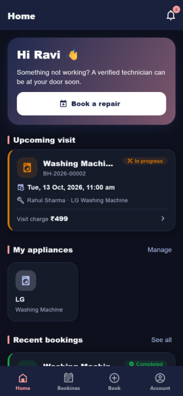 | 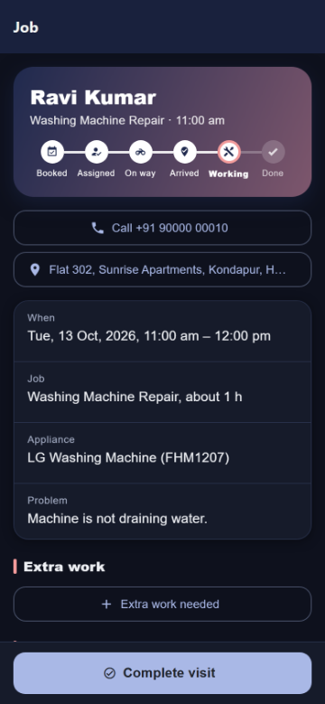 | 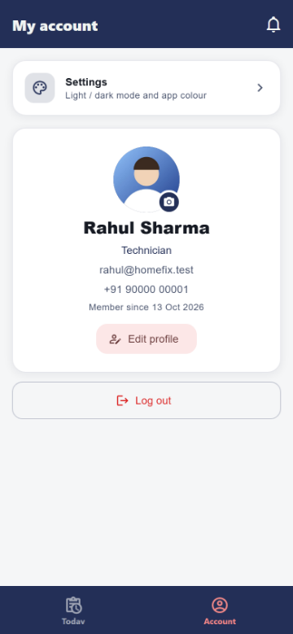 | 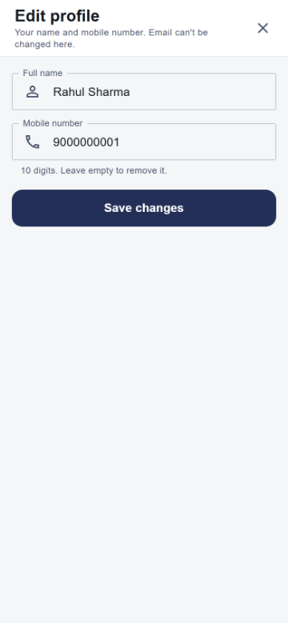 |

### Eight app colours

The same palettes as the web app's sidebar, in light and dark mode. The choice is saved on the device.

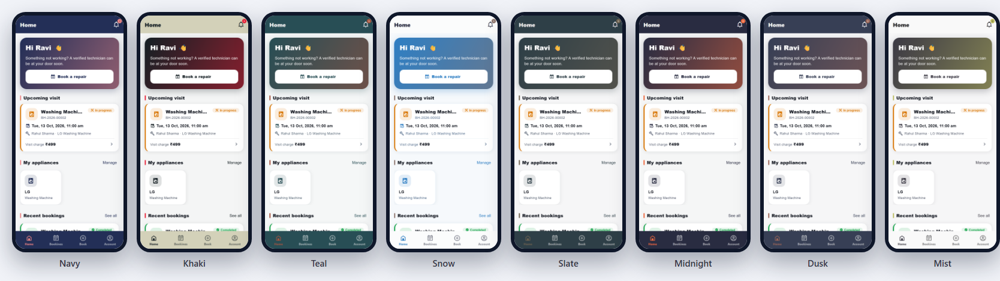

## How it works

- **The server decides.** Free time slots, prices, totals, allowed status changes and permissions all come from the API.
  The app shows what the API returns and sends what the user picked. Hiding a button is only for looks; the API checks
  role and ownership on every request.
- **No double booking.** Two people can tap the same slot at the same moment. A PostgreSQL exclusion constraint on the
  backend makes the second booking fail, and the app asks the user to pick again from a fresh list.
- **India time everywhere.** Dates and times are shown in `Asia/Kolkata`, whatever the phone's own time zone.
- **Login.** The app logs in with `X-Client: mobile`, keeps the JWT in the phone's secure keystore (`expo-secure-store`)
  and sends it as `Authorization: Bearer <token>`. A 401 logs out and clears all cached data.
- **Payments.** A customer pays a completed visit with Razorpay's native checkout (`react-native-razorpay`). The server
  creates the order and the amount and verifies Razorpay's signature before marking the booking paid. Test mode only.
- **Notifications and email.** Booking confirmed, technician assigned or on the way, extra charge to approve, visit
  completed, reminders 24 hours and 2 hours before the visit: the backend sends these by email (a background worker with
  pg-boss and Nodemailer) and as in-app notifications behind the bell.
- **One-time codes.** Reset-password, invite and verification emails include a 6-digit code, so the app finishes these
  flows without a web link ("Forgot password", "I have a code from HomeFix", "Verify your email"). Staff can also create
  a code for a customer and read it out over the phone. Codes work once, for 15 minutes, with 5 tries.

## Tech stack

- **App:** React Native 0.86, Expo SDK 57, Expo Router (file-based screens), TypeScript
- **UI:** React Native Paper (Material 3), react-native-paper-dates, expo-linear-gradient, custom theme with 8 palettes
- **Data and forms:** TanStack Query, React Hook Form, Zod
- **Native:** expo-secure-store, react-native-razorpay, expo-image-picker and expo-image-manipulator (profile photos)
- **Builds:** EAS Build (development APK)
- **Tests:** Vitest (unit), Playwright end-to-end on phone-sized screens (Pixel 7 and iPhone 14 sizes)

## Getting started

You need Node.js 22+, PostgreSQL and the backend running. Full step-by-step instructions, including building the APK and
testing payments, are in the **[setup guide (PDF)](docs/HomeFix-Mobile-Guide.pdf)**.

1. **Backend** (in the backend repo): `npm install`, copy `.env.example` to `.env`, `npx prisma migrate dev`,
   `npm run seed`, then `npm run dev` (port 4000).
2. **App** (here):
   ```bash
   npm install
   copy .env.example .env
   ```
   Set `EXPO_PUBLIC_API_URL` in `.env` to your PC's Wi-Fi address, e.g. `http://192.168.1.5:4000` (find it with
   `ipconfig`; on the Android emulator use `http://10.0.2.2:4000`). Phone and PC must be on the same Wi-Fi, and Node.js
   must be allowed through the firewall on private networks.
3. **Run:**
   ```bash
   npx expo start
   ```
   Scan the QR code with **Expo Go**, or open it in the development build (below).

Check from the phone's browser first: `http://<your PC's IP>:4000/health` should answer `{"status":"ok"}`.

### Development build (needed for Razorpay)

Expo Go can't contain Razorpay's native code, so Pay online is hidden there. Build the app once in Expo's cloud with a
free Expo account and install the APK on the phone:

```bash
npx eas-cli@latest build --profile development --platform android
```

Then run `npx expo start` and open the project in the installed **HomeFix** app. A new APK is only needed when a library
with native code changes; screens and logic come from `expo start`. Before each build, raise `version` and
`android.versionCode` in `app.json`. The login screen and Settings → About show the installed version and the code
version, so you always know what is running.

To test a payment: the backend needs Razorpay **test** keys, and the booking must be completed but not paid. In the
Razorpay screen choose UPI and enter `success@razorpay`, or Netbanking and **Success** on the test bank page.

### Demo logins

From the backend's demo data, password `Password@123`. In development the login screen has buttons that fill these in.

| Role | Email |
| --- | --- |
| Owner | `owner@homefix.test` |
| Manager | `manager@homefix.test` |
| Technician | `rahul@homefix.test` |
| Customer | `ravi@example.test` |

## Project structure

```
app/                  Screens (Expo Router: the file path is the route)
  _layout.tsx         Theme, session check, keeps each role inside its own area
  (auth)/             Log in, register, forgot password, "I have a code"
  (customer)/         Tabs (home, bookings, book, account), booking detail, receipt
  (tech)/             Today's jobs, job screen, receipt
  (staff)/            Dashboard, bookings, customers, technicians, reports, users, audit, roles…
src/
  features/           Screen content by topic: booking/, staff/, tech.tsx, Settings.tsx…
  lib/                API client, auth, query hooks, Zod schemas, IST date and money formatting,
                      appearance (mode and colour), Razorpay, version
  ui/                 Theme (all colours), cards, forms, pickers, navigation, charts
e2e/                  Playwright end-to-end tests
demo/                 Demo video recorder and screenshot script
scripts/              patch-expo-ui.js (see Notes)
docs/                 Setup guide (PDF) and screenshots
```

## Scripts

| Command | What it does |
| --- | --- |
| `npx expo start` | Start the app server (Expo Go or the development build) |
| `npm run web -- --port 3000` | Open the app in a browser (port 3000 matches the backend's CORS setting) |
| `npm run typecheck` | TypeScript |
| `npm run lint` | ESLint |
| `npm test` | Unit tests (IST dates, money, time-off helpers) |
| `npx playwright test` | End-to-end tests: customer books and cancels, staff books for a customer, technician completes a visit and records cash, owner opens Roles, dark mode persists. Starts its own API and app on a separate, freshly seeded database. |
| `npm run shots` | Screenshots of the main screens in every app colour, light and dark, with a check that nothing is cut off |
| `npm run demo` | Records the demo clips (Full HD, phone frame) into `demo-videos/` |

## Notes

- **Expo UI fix.** `scripts/patch-expo-ui.js` runs after every `npm install`. In Expo SDK 57, `@expo/ui` (used by
  expo-router) can crash the Android development build with `UnsatisfiedLinkError … clearAllContentOrigins` when the
  launcher opens the app; the script makes that one clean-up call safe. It can be removed once Expo fixes it.
- **HTTP.** Plain `http://` to a PC on the same Wi-Fi is fine for development. A release build must use the HTTPS backend.
- **Secrets.** `.env` is not committed, and Razorpay runs in test mode only.

## License

MIT — see [LICENSE](LICENSE).
